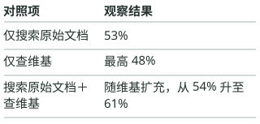
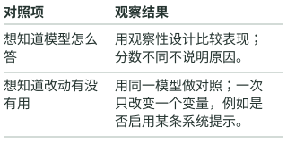
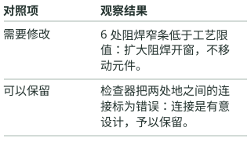

# Agent 系统日报 · 2026-11-22

*首次入选*　**上下文与记忆**　2026-11-06　Anthropic Engineering

## The components of agent memory

### 推荐理由

旧笔记反复把代理带回同一个错误时，值得先做日志回查。需要反复拼接多份文档的任务，则适合评估后台整理知识页的成本。

### 内容摘要

一条错误的地标笔记让 Claude 三次走回旧路。让它在后台翻查会话记录、改写笔记后，下一次运行终于穿过了山洞。

**记下验证过的规则**

在 CL-Bench 的数据库问答中，Claude 每答一题就会收到正确解答。下一题从新会话开始，但仍能读取同一个记忆目录。Sonnet 4.6 留下的是未经检验的错因猜测；Opus 5 则把验证过的规则、验证依据和踩过的坑一起写下来。这样的笔记不必复述整个过程，却能让新会话看清哪些经验可以直接用，哪些还需要验证。 [原文章节](https://www.anthropic.com/research/components-of-agent-memory#memory-can-be-a-prediction-about-what-the-future-will-need)

**一条错笔记如何带偏导航**

在《宝可梦 红》里，Claude 把月见山入口旁的宝可梦中心误记在山的东侧，以为自己已经穿过山洞。在沿用错笔记的那次运行中，它三次跌回原路，最终没到下一座城。研究者让 Claude 另做一轮整理，也就是文中说的「做梦」：对照原始会话记录找出错误，改写笔记。用修正后的笔记重跑时，Claude 直接返回山洞，最终抵达华蓝市。 [原文章节](https://www.anthropic.com/research/components-of-agent-memory#dreaming-can-correct-memory)

**月见山案例里的记忆修正**

1. 错误地标进入笔记
2. 新会话沿旧路折返
3. 对照会话记录改写地标
4. 重新进入山洞

**内部文档问答：25 道题的评分项得分率** [原文章节](https://www.anthropic.com/research/components-of-agent-memory#dreaming-can-build-new-memory-representations)

### 延伸思考

**如果后台整理的算力只够检查一部分笔记，该先查哪些？**

作者指出，边做边记能让笔记及时可用，却会分散智能体对当前任务的注意力；移到后台整理则要额外花算力，结果也未必赶得上下一次会话。工程上可以先保留可检索的会话记录，只把值得跨会话复用的经验写成笔记。需要控制维护成本时，可优先回查常被读取或容易过时的笔记，而不是每轮重查全部。文章没有给出通用的整理频率。 [原文章节](https://www.anthropic.com/research/components-of-agent-memory#thinking-backward-looking-forward)

[英文原文](https://www.anthropic.com/research/components-of-agent-memory)

*首次入选*　**评测与可靠性**　2026-11-13　Anthropic Engineering

## Building strong safety evaluations

### 推荐理由

适合负责上线评审的工程师。文章演示怎样把单一分数拆成逐轮评分、版本差值和置信区间。

### 内容摘要

一次多轮安全评测里，两个模型的合宜回应率相差 4 个百分点。考虑抽样误差后，这组结果不足以排出高下。

**先定义什么叫应对得当**

拒答率高，不代表模型更安全。比如用户透露自伤风险时，一味拒答反而可能漏掉提供支持的机会；更合适的回应要表达关切、避免讨论具体方法，并在恰当时机引导用户寻求人工支持。Anthropic 让领域专家针对不同风险制定评分规则，再逐轮检查对话。开头答得好不能抵消后续失误：只要有一轮应对不当，整段就不算通过。 [原文章节](https://www.anthropic.com/research/building-strong-safety-evaluations#measure-what-you-mean-to-measure)

**差 4 个百分点，仍不能判高下**

Anthropic 在 claude.ai 上用多轮对话测试模型能否始终妥善应对恋爱诈骗相关请求。以各模型的全部受测对话为分母，整段应对均合宜的比例，Claude Opus 5 为 98%，Opus 5.5 为 94%。两者相差 4 个百分点，但差异未达到统计显著性。作者没有据此判定哪个模型更好：这既不能证明旧版更安全，也不能证明两版表现相同。 [原文章节](https://www.anthropic.com/research/building-strong-safety-evaluations#report-statistics-fully)

**评估设计取决于你想回答的问题** [原文章节](https://www.anthropic.com/research/building-strong-safety-evaluations#match-the-design-to-the-question)

### 延伸思考

**评测结果落在误差范围内时，团队依据什么决定上线？**

如果你要用评估结果做上线决策，建议在跑分前写清主指标、要比较的版本、要单独报告的场景，以及多大的退步会触发复核。让两个版本跑同一批用例，每个用例重复运行，再根据同一用例上的分数差计算置信区间。上线评审时把差值和区间放在一起看；如果仍分不清实际差异和抽样波动，就先补测，不要把高分当作放行理由。 [原文章节](https://www.anthropic.com/research/building-strong-safety-evaluations#preregister)

[英文原文](https://www.anthropic.com/research/building-strong-safety-evaluations)

*首次入选*　**工具与执行**　2026-11-09　Anthropic Research

## Testing Claude on real-world electronics design

### 推荐理由

当代理能调用 CAD 和设计规则检查器时，团队可以把首版设计交给它，把实物装配、测量和放行决定留给工程师。

### 内容摘要

Claude 为三款设备画板、设计外壳并写固件，工程师装出的原型都能运行。样机仍需电气、热和制造验证。

**从一句需求到可装配样机**

硬件设计不只是按数据手册把芯片接起来：元件放在哪儿决定铜线怎么走，电路板还要装进外壳，零件也得买得到、工厂也得做得出来。Anthropic 与 Diode 从简短需求起步，让 Claude Fable 5.2 为免提通话音箱、语音助手中枢和手持电子宠物设计电路板与外壳、编写固件并列出物料清单。Diode 装出三款样机，均无需修改电路就能运行。 [定位原句](https://www.anthropic.com/research/claude-electronics-design#:~:text=worked%20without%20any%20fixes%20to%20their%20circuitry)

**先布高速线，再看基准差距**

在语音助手中枢上，Fable 5.2 先布 USB 和以太网的差分线：控制每对铜线的间距，用小段折线补齐长度，让成对信号同时到达。Diode 的内部基准 PCB Gym 移除原布局，要求模型重摆元件、重画铜线。按满分计，Fable 5.2 得 69%，Fable 5 得 25%，相差 44 个百分点。这是布局布线得分，不是实板一次通过率。 [原文章节](https://www.anthropic.com/research/claude-electronics-design#reasoning-through-geometric-problems)

**语音助手中枢：两类制造检查告警怎么处理** [原文章节](https://www.anthropic.com/research/claude-electronics-design#designing-for-real-world-manufacturing)

### 延伸思考

**从可运行样机到量产，哪些验证必须由工程师接手？**

三款样机尚未做电气验证、天线调谐、热测试或认证，也不是按量产要求设计的。Claude 没有接入测试仪器或制造设备，实物制作和测试由 Diode 工程师完成。对软件团队，更稳妥的试法是让模型负责用于功能验证的首版设计，同时在排期里保留人工审板和台架测量。把样机能运行当作继续验证的起点，而不是投产的放行条件。 [原文章节](https://www.anthropic.com/research/claude-electronics-design#limitations-and-next-steps)

[英文原文](https://www.anthropic.com/research/claude-electronics-design)
