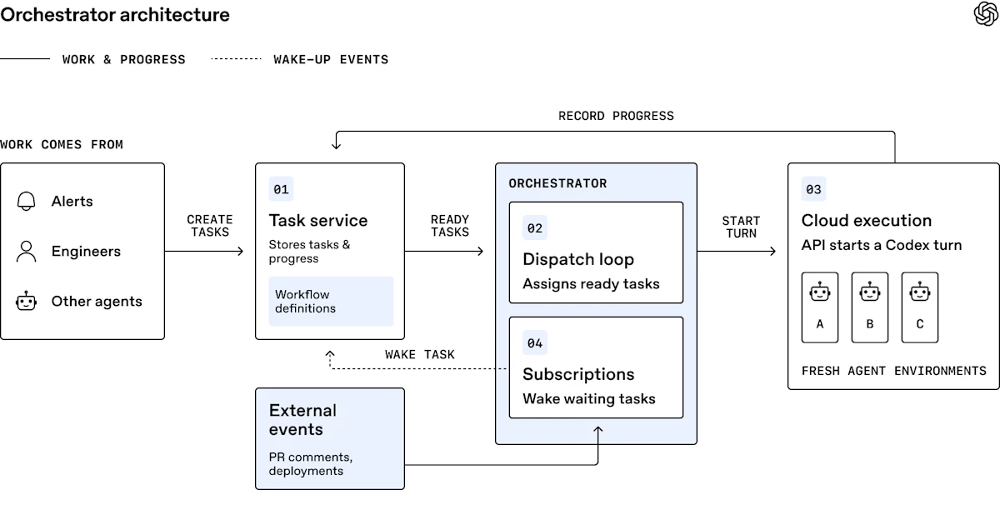
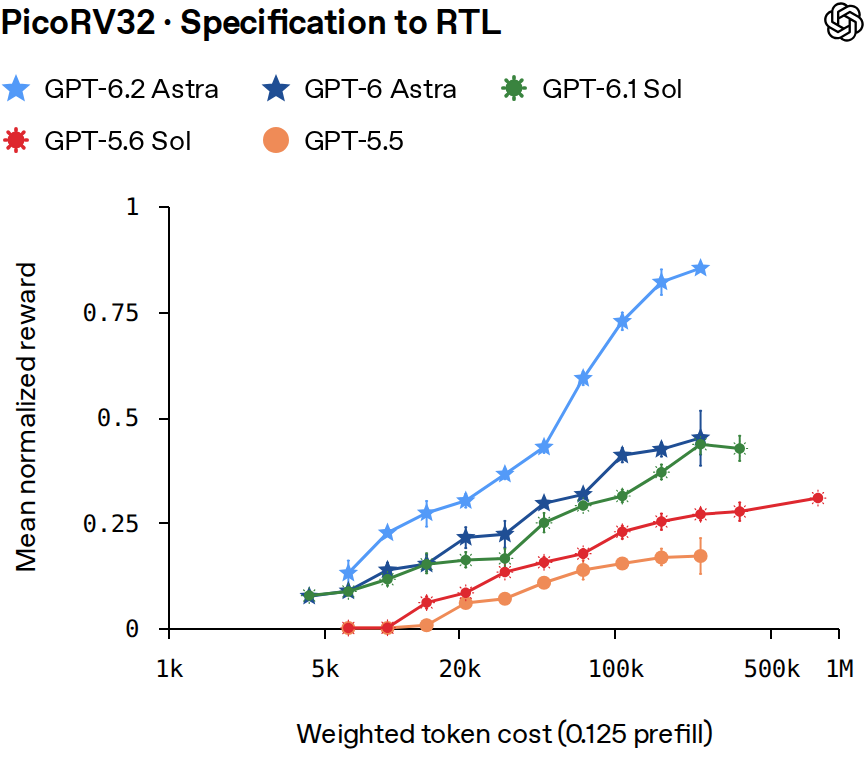
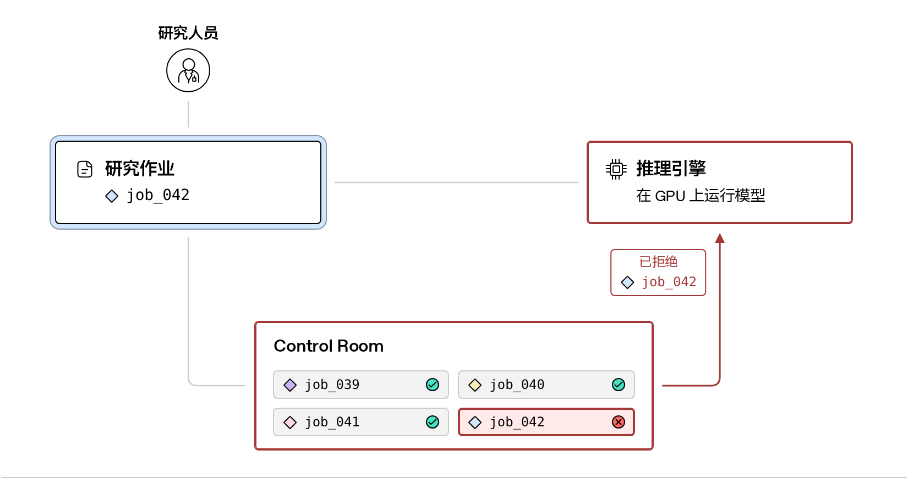

# Agent 系统日报 · 2026-11-24

*首次入选*　**性能工程**　2026-11-19　OpenAI

## How OpenAI’s Performance Factory keeps ChatGPT fast

### 推荐理由

如果你在搭建值班助手，这篇能帮你决定何时让它继续排查，何时值得请工程师审查修复。

### 内容摘要

三个多月里，OpenAI 用 Codex 跟踪了 1,700 多次性能回归调查，600 多起定位到根因。排查先按请求类型拆分延迟，区分同类请求变慢和慢请求占比上升，再结合发布记录与调用链寻找原因。

一个独立的 Codex 会话尝试推翻初步诊断。工程师审核修复，上线后再由 Agent 核对指标是否恢复。诊断仍需人工判断：团队抽查了 100 条根因建议，70 条准确，其余需要补证或细化。 [原文章节](https://openai.com/en-US/index/how-openai-performance-factory-keeps-chatgpt-fast/#adversarial-review-strengthens-the-diagnosis)

**性能工厂如何调度任务**　任务服务保存进度，调度器把就绪任务交给云端 Codex。等待中的任务可由代码评审或部署事件唤醒。 [OpenAI 原图出处](https://openai.com/en-US/index/how-openai-performance-factory-keeps-chatgpt-fast/#the-performance-factory-systems-four-parts)

### 延伸思考

一次图片下载故障中，负责定位文件的服务已经恢复，图片请求却仍在失败。复核会话据此重新打开了调查。 [原文章节](https://openai.com/en-US/index/how-openai-performance-factory-keeps-chatgpt-fast/#adversarial-review-strengthens-the-diagnosis)

给值班助手设计交接条件时，可以要求它写明“如果诊断成立，哪组请求应当恢复”，再附上那组请求的曲线。两个会话赞同同一解释，提供的证据可能仍然只有一份。

[英文原文](https://openai.com/en-US/index/how-openai-performance-factory-keeps-chatgpt-fast/)　[官方中文译文](https://openai.com/zh-Hans-CN/index/how-openai-performance-factory-keeps-chatgpt-fast/)

*首次入选*　**硬件设计评测**　2026-11-18　OpenAI

## Advancing chip design with OpenAI models

### 推荐理由

适合需要用基准分数挑选硬件设计工具的人。读完可以对照真实芯片上验证过的改动，判断测试高分能说明什么。

### 内容摘要

模型为 Jalapeño 芯片提出的电路改动，估算让向量单元的标准单元面积减少约 13%，矩阵单元减少约 10%。改动涉及加法器、乘法器和流水线安排，团队已在硅片上验证了这些改动。

研究者另用两个开源 RISC-V 核比较“优化现有设计”和“按规格重写”，用隐藏负载上的估算吞吐量评分。每次约 11.2 万 token 时，五个模型在两个核上都是重写得分更高。 [原文章节](https://openai.com/en-US/index/advancing-chip-design-with-our-models/#designing-a-risc-v-core-from-a-specification)

**PicoRV32 · Specification to RTL**　OpenAI 英文原图。横轴为加权 token 成本（预填充权重 0.125），纵轴为平均归一化奖励。在约 11.2 万 token 处，GPT‑6.2 Astra 的平均值超过 0.7。 [OpenAI 原图出处](https://openai.com/en-US/index/advancing-chip-design-with-our-models/#picorv32-specification-reward)

### 延伸思考

作者指出，书面规格允许重写版省去原核的性能计数器和部分指令，而这些功能对测试负载的吞吐量贡献可能很小。 [原文章节](https://openai.com/en-US/index/advancing-chip-design-with-our-models/#designing-a-risc-v-core-from-a-specification)

如果要据此决定是否重写产品里的处理器，值得把这些功能列为必选项，两版采用相同的面积上限，再用物理综合后的频率计算吞吐量。此时仍领先，才更有理由把收益归于新的微架构。

[英文原文](https://openai.com/en-US/index/advancing-chip-design-with-our-models/)　[官方中文译文](https://openai.com/zh-Hans-CN/index/advancing-chip-design-with-our-models/)

*首次入选*　**推理运行控制**　2026-11-09　OpenAI

## Control Room: A central system to track and stop model workloads across our research infrastructure

### 推荐理由

如果多个 Agent 共用推理服务，这篇能帮你给停止按钮定验收标准，包括何时必须停、哪些作业还能继续。

### 内容摘要

Control Room 可以切断一个研究作业的模型输出，让同一引擎继续服务其他获准作业。每个作业在推理请求中附上 ID，由引擎核验授权；即使作业进程没退出，引擎也能对这个 ID 拒绝后续推理。

为支撑请求量，引擎会缓存授权。Control Room 收到停机指令后，到目标作业无法继续推理，最长可能相隔 35 秒。这个上界从收到指令算起，故障发现和人工决策耗时要另算。 [原文章节](https://openai.com/en-US/index/control-room/#speed-and-reliability)

**一个作业被撤权后**　原文交互图第 12 步。Control Room 拒绝 job\_042 的下一次推理授权，图中另外三个作业仍获准运行。 [OpenAI 原图出处](https://openai.com/zh-Hans-CN/index/control-room/#4t9Yu5Vdp7LCXHV56T7lx1)

### 延伸思考

对启用了故障关闭机制的工作负载，授权服务一旦失联，引擎会拒绝所有推理请求，直到控制服务恢复。 [原文章节](https://openai.com/en-US/index/control-room/#speed-and-reliability)

验收时可以让两个作业共用引擎。第一次只撤销一个 ID，分别记录被停作业的最后输出和另一个作业的下一次成功采样；第二次让授权服务离线，记录两者何时都停止输出。两次试验覆盖不同的故障范围。

[英文原文](https://openai.com/en-US/index/control-room/)　[官方中文译文](https://openai.com/zh-Hans-CN/index/control-room/)
