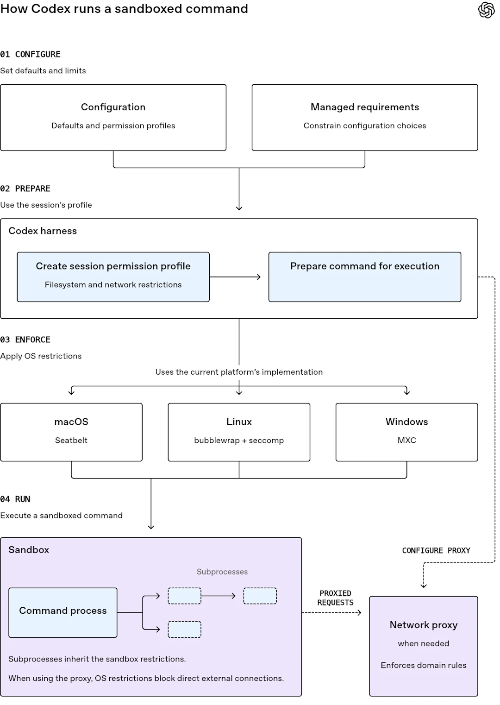

# Agent 系统日报 · 2026-11-25

*首次入选*　**工具结果交付**　2026-10-30　arXiv

## Fidelity Collapses with Table Size, Not Turn Count: Delivery Architecture in a Deployed Tool-Using Agent

### 推荐理由

为多轮查询智能体制定验收标准的工程师，可据此判断是否要按输入表的行数分档，逐档核对筛选结果。

### 内容摘要

在机票查询实验中，让模型筛选并重述记录时，输入表越大，首次筛选就越容易答错。旁路方案把记录留在会话状态，让模型生成筛选参数，由工具执行筛选，再通过类型化通道交付结果行。

作者从六条航线同一舱等的冻结结果中各取前若干行，每次都只筛选下午起飞的航班。输入从 5 行增至 100 行时，Gemini 2.5 Flash 重述结果的满分率从 83% 降至 6%，旁路在整组实验的 93 次运行中均获满分。 [原文章节](https://arxiv.org/html/2611.00442v1#S5.SS1.SSS0.Px1)

**图 2 · 工具结果表变长时，交付准确率如何变化**　同一份结果按行扩展。六条航线汇总后，Flash 转述组在 100 行时的准确率降至 6%，直接交付组的 93 次运行均正确。阴影为 95% Wilson 区间。 [arXiv 原图出处](https://arxiv.org/html/2611.00442v1#S5.F2)

### 延伸思考

实验同时引入了跨轮保存记录和绕过模型交付结果两项改动，只测出了两者的合计收益。 [原文章节](https://arxiv.org/html/2611.00442v1#Sx1.SS0.SSS0.Px4)

可固定会话状态和筛选参数，按业务中常见的表长回放，对两条路径逐行核对记录及字段。若模型重述在常见的最大表上也能稳定达到验收标准，可暂缓引入旁路。

[英文原文](https://arxiv.org/html/2611.00442v1)

*再度入选*　**命令执行沙箱**　2026-11-18　OpenAI

## Inside the Codex sandbox

### 推荐理由

接入本地 MCP 服务的开发者可参考文中的记忆服务示例，判断哪些依赖可以提前备好，以及服务运行时还需要写入哪些目录。

> 上次入选于 2026-11-21

### 内容摘要

Codex 的命令沙箱也能约束本地 MCP 服务。在沙箱内启动服务后，所选配置对文件和网络访问的限制会由子进程继承。

作者先为记忆服务创建数据目录并缓存固定版本的 npm 包，再用 codex sandbox 按专用配置启动服务。在这些条件下，该服务可以离线启动，写入范围仅限于 npm 缓存和服务数据目录。 [定位原句](https://openai.com/en-US/index/inside-the-codex-sandbox/#:~:text=without%20network%20access%2C%20with%20writes%20limited%20to%20the%20npm%20cache%20and%20the%20server%E2%80%99s%20data%20directory)

**Codex 如何把权限配置应用到命令**　Codex 按会话权限配置启动命令，子进程继承沙箱限制。启用网络代理时，由代理执行域名规则。 [OpenAI 原图出处](https://openai.com/en-US/index/inside-the-codex-sandbox/)

### 延伸思考

对于配置文件中通过 stdio 接入的 MCP 服务，Codex 无法可靠推断它需要哪些文件或网络服务，因此不会自动将启动命令放入沙箱。 [原文章节](https://openai.com/en-US/index/inside-the-codex-sandbox/#example-sandboxing-an-mcp-server)

建议先在禁网条件下测试启动和一次典型工具调用。若调用只有在特定域名可达时才成功，就为该服务配置代理，只放行该域名。

[英文原文](https://openai.com/en-US/index/inside-the-codex-sandbox/)　[官方中文译文](https://openai.com/zh-Hans-CN/index/inside-the-codex-sandbox/)

*首次入选*　**智能体记忆层**　2026-10-28　LangChain

## Building Evidence-Grounded Agent Memory with OpenWiki and Graphs

### 推荐理由

需要复核智能体答案出处的工程师，可参考文中对引用重合度的评测，判断是否值得为维基中的陈述建立通往原文段落的证据图。

### 内容摘要

在跨文档问答中，OpenWiki 把分散的条款关系整理成维基，让智能体答得更准。用证据图把维基中的陈述连到原文段落后，多次作答时引用的依据也更稳定。

作者用 111 份合成保险文档测试同一智能体，每题作答三次。在 50 道跨文档题上，准确性得分从关键词搜索的 0.10 升至使用维基的 0.52。相比单用维基，加入证据图后得分又提高了 27%，引用重合度翻倍。 [定位原句](https://www.langchain.com/blog/building-agent-memory-openwiki-graphs#:~:text=Accuracy%20rose%2027%25%2C%20citation%20consistency%20doubled)

**三种记忆方案怎样回答跨文档查询**　作者比较了三种方案。从单用 wiki 到加入证据图，正确率从 0.52 升到 0.66，中位回答时间从 30 秒降到 18 秒。 [LangChain 原图出处](https://www.langchain.com/blog/building-agent-memory-openwiki-graphs#:~:text=Better%20accuracy%2C%20lower%20cost%2C%20faster%20answers)

### 延伸思考

在单段查找题上，搜索和维基的得分接近，用时分别为 9 秒和 12 秒。文中每答对一题的成本只含检索与作答。 [定位原句](https://www.langchain.com/blog/building-agent-memory-openwiki-graphs#:~:text=while%20latency%20increased%20from%209%20to%2012%20seconds)

可按实际提问频率重放两类查询，把编译和更新费用摊入每道答对的题。若维基在跨文档题上仍能提高得分，且每答对一题的总成本低于搜索，就为这类任务启用共享维基。

[英文原文](https://www.langchain.com/blog/building-agent-memory-openwiki-graphs)
