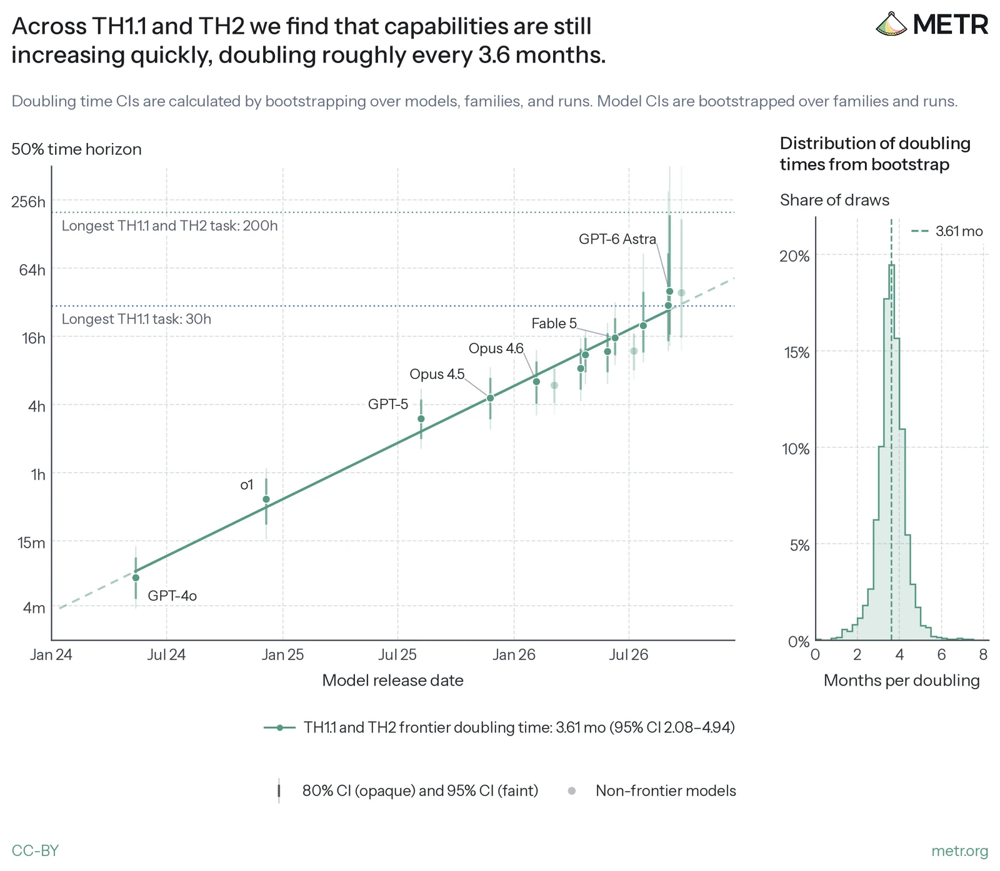
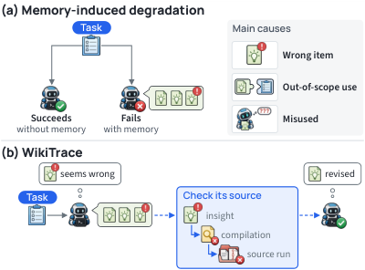
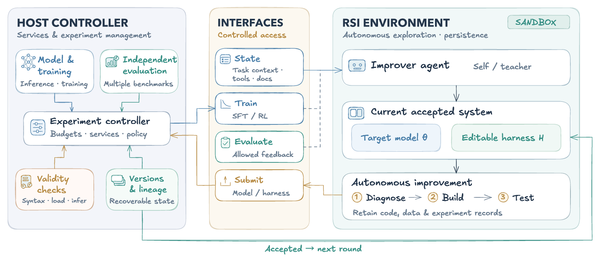

# Agent 系统日报 · 2026-11-25

*首次入选*　**长程任务**　2026-11-20　METR

## AI R&D-relevant model capabilities are improving rapidly and are getting harder to measure

### 核心看点

**METR 用专家完成同一道题所需的工时衡量任务长度，发现 Agent 有五成把握做完的任务，约每 3.6 个月翻一倍**。换成需要自己判断研究方向的工作，单看这条曲线，很难估计 Agent 究竟能接手多少。

### 内容摘要

研究者先估算专家要花多少工时才能达到指定成绩，再看每一代模型在多长的任务上仍有一半机会达到同一成绩。

合并新旧两套测试，翻倍时间估计为 3.61 个月，95% 置信区间为 2.08 至 4.94 个月。这里的“小时”指专家工时。模型本身可能跑得快得多。 [原文章节](https://metr.org/blog/2026-11-20-q4-2026-capability-update/#3c1-across-th11-and-th2-we-find-that-capabilities-are-doubling-roughly-every-36-months)

**原文图 10 · 有五成把握完成的任务有多长**　左图按模型发布日期排列，纵轴是完成同一任务所需的人类工时。右图给出重复抽样得到的翻倍时间分布。来源：METR，CC BY。 [METR 原图出处](https://metr.org/blog/2026-11-20-q4-2026-capability-update/#3c1-across-th11-and-th2-we-find-that-capabilities-are-doubling-roughly-every-36-months)

### 延伸思考

METR 请模型设计短时间内难以判断好坏的评测题，模型仍倾向于出能自动算分的优化题。交上来的题，没有一道被 METR 用进这份报告。 [原文章节](https://metr.org/blog/2026-11-20-q4-2026-capability-update/#3b2-on-domains-where-the-true-quality-of-a-solution-is-hard-for-the-agent-to-determine-due-to-prohibitively-long-feedback-loops-or-requirements-that-the-solution-generalize-models-appear-to-have-worse-judgment-than-human-experts)

优化代码可以马上计时，判断研究方向是否有价值可能要等很久。读增长曲线时，人类工时本身也有不确定性。这份报告里只有约 9% 的工时估计直接用了人员实测。

[阅读原文](https://metr.org/blog/2026-11-20-q4-2026-capability-update/)

*首次入选*　**经验记忆**　2026-11-10　arXiv

## Don’t Just Trust Your Memory: Evidence-Linked Memory Reduces Memory-Induced Degradation in LLM Agents

### 核心看点

**给 Agent 同一份经验笔记，让它回查当时做过什么，它就更少把原本会做的题做错**。五套基准共八组测试中，拿到原始记录和回查提示的 Agent，平均比只看笔记多得 3.2 分。

### 内容摘要

一条旧笔记说，把物品放在亮灯旁就算完成任务。轮到检查花瓶，Agent 只开灯就交差。它本来知道要先拿起花瓶。

WikiTrace 给每条经验连上产生它的原始操作和对这次成败的解释。作者比较了拿到相同经验的两组，既看新做对多少题，也查原来会做的题又错了多少。 [原文章节](https://arxiv.org/html/2611.14320v1#S3.SS2)

**原文图 1 · 一条经验怎样把 Agent 带偏**　上半部列出记忆里的错误、超出适用范围及误用。下半部展示 Agent 沿链接回到原始记录，核查并改正经验。 原图作者为 Yukyeong Lee 等人（CC BY 4.0）。 [arXiv 原图出处](https://arxiv.org/html/2611.14320v1#S1.F1)

### 延伸思考

如果只报总分，新增的正确答案可能盖住被坏经验教错的旧题。测试记忆功能时，可以留一组助手原先稳定做对的任务，专门数它学坏了多少。 [原文章节](https://arxiv.org/html/2611.14320v1#S5.SS4)

这次实验中，带回查的系统每题平均推理成本比只给经验高 17%。如果笔记多到无法一次全部给模型，每道题该找出哪些笔记，还有待验证。

[阅读原文](https://arxiv.org/html/2611.14320v1)

*首次入选*　**自我改进**　2026-11-01　arXiv

## RSI-Env: An Open-Ended Environment for Recursive Self-Improvement of Agents

### 核心看点

**一次实验中，Agent 连续改进自己两轮，事实问答更准了，科学推理却退步了**。事实问答正确率从 82% 升到 85%，再到 88%，科学推理正确率则从最初的 65.2% 降到最终的 53.0%。

### 内容摘要

第一轮，Agent 只改了模型周围调用工具、执行任务的程序，模型参数没动。第二轮，这个新版本自己写出 48 条训练样本，再用它们训练模型。

作者在固定的 500 道 SimpleQA 事实题上评估，每题做三次取平均，才得到 82%、85%、88% 这三个数。 [原文章节](https://arxiv.org/html/2611.01736v1#S4.SS5)

**原文图 1 · 改过的系统怎样接手下一轮**　右侧的当前版本包括模型和可编辑的运行程序。底部的回路表示已接受的版本进入下一轮。左侧的控制器独立管理版本和评估。 [arXiv 原图出处](https://arxiv.org/html/2611.01736v1#S2.F1)

### 延伸思考

第一轮改出来的版本亲自完成了第二轮，这才让我们看见自我改进如何延续。两次进步之后，下一代还能找出管用的改动吗？ [原文章节](https://arxiv.org/html/2611.01736v1#S4.SS2)

另一个值得看的数字是它在其他科目丢了多少分。科学推理的回落提醒我们，看自我改进演示时，要同时看目标任务和原先就会的任务。

[阅读原文](https://arxiv.org/html/2611.01736v1)
