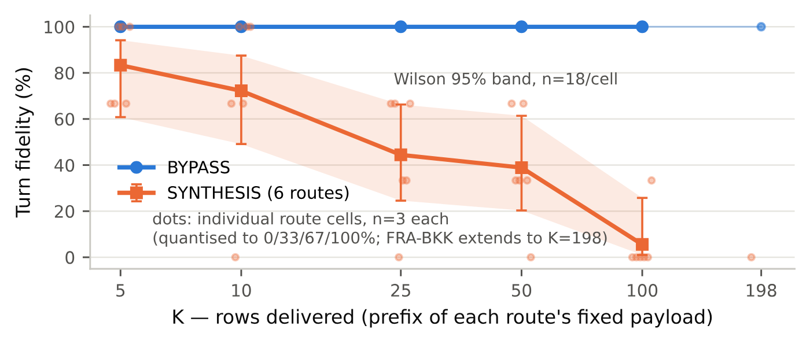
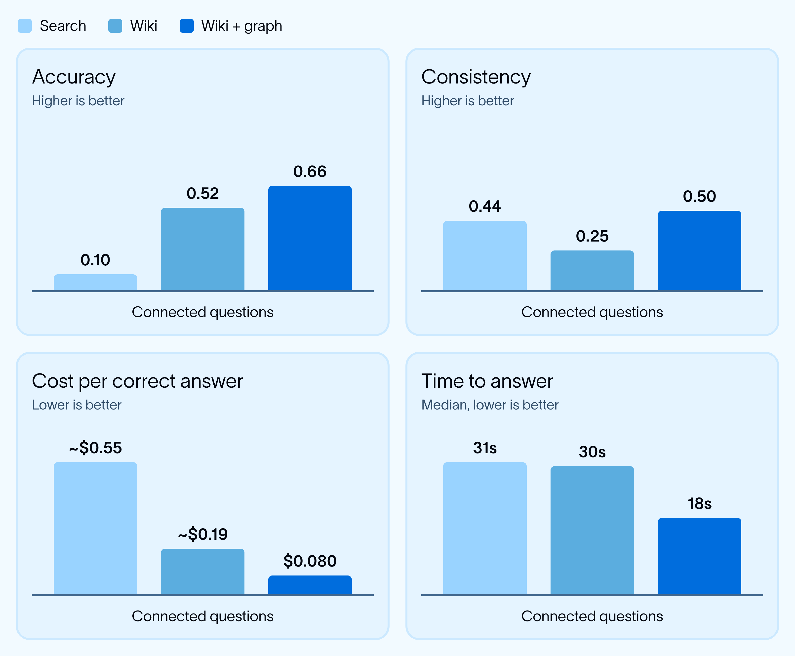

# Agent 系统日报 · 2026-11-25

*首次入选*　**航班清单**　2026-10-30　arXiv

## Fidelity Collapses with Table Size, Not Turn Count: Delivery Architecture in a Deployed Tool-Using Agent

### 核心看点

订票助手查到了航班，为什么最后给你的清单还会错？研究者让助手挑出下午起飞的航班。清单越长，模型重新列出结果时越容易出错；让模型只说筛选条件，由程序直接交付符合条件的航班，这组实验里 93 次都答对了。

### 内容摘要

研究者保存了六条航线的查询结果。每次从同一张表的开头多取一些航班，再问同一个问题。这样就能单独观察清单变长的影响。

让 Gemini 2.5 Flash 自己列出航班时，输入 5 行，83% 的回答拿到满分；输入 100 行，只有 6%。差距在第一次筛选时就出现了。 [原文章节](https://arxiv.org/html/2611.00442v1#S5.SS1.SSS0.Px1)

**图 2 · 工具结果表变长时，交付准确率如何变化**　同一份结果按行扩展。六条航线汇总后，Flash 转述组在 100 行时的准确率降至 6%，直接交付组的 93 次运行均正确。阴影为 95% Wilson 区间。 [arXiv 原图出处](https://arxiv.org/html/2611.00442v1#S5.F2)

### 延伸思考

直接交付清单的方案还做了另一件事：它把原始记录保存在会话里。实验测到的是两项改动加在一起的效果。 [原文章节](https://arxiv.org/html/2611.00442v1#Sx1.SS0.SSS0.Px4)

下次看助手演示订票或查库存，可以让它处理一张长表，把最终清单和工具查到的记录逐行对一遍。屏幕上的“查询成功”只回答了前半个问题。

[英文原文](https://arxiv.org/html/2611.00442v1)

*再度入选*　**工具权限**　2026-11-18　OpenAI

## Inside the Codex sandbox

### 核心看点

给编程助手装一个记笔记的工具，它能改动电脑上的哪些文件？在 Codex 里，按文中的默认方式接入这个本地工具，它就有了和你一样的文件与联网权限。作者让它照样能记笔记，却只能写两个指定目录，连网也用不着。

> 上次入选于 2026-11-21

### 内容摘要

这个记忆工具通过 MCP 接入 Codex，在你的电脑上作为单独的程序运行。文章考察的是一种叫 stdio 的本地连接方式。作者先建好笔记目录，把指定版本的软件包下载到缓存，再把工具放进沙箱，也就是一个限制程序权限的运行环境。

下次启动时，工具从缓存读软件包，把笔记存进数据目录。即使关闭网络、只允许写入缓存和数据目录，它也能启动。 [定位原句](https://openai.com/en-US/index/inside-the-codex-sandbox/#:~:text=without%20network%20access%2C%20with%20writes%20limited%20to%20the%20npm%20cache%20and%20the%20server%E2%80%99s%20data%20directory)

**Codex 如何把权限配置应用到命令**　Codex 按会话权限配置启动命令，子进程继承沙箱限制。启用网络代理时，由代理执行域名规则。 [OpenAI 原图出处](https://openai.com/en-US/index/inside-the-codex-sandbox/)

### 延伸思考

Codex 单凭启动命令，推断不出一个工具为了工作需要哪些文件或网络服务。这些权限要由接入工具的人决定。 [原文章节](https://openai.com/en-US/index/inside-the-codex-sandbox/#example-sandboxing-an-mcp-server)

看一个工具的安装说明时，可以找两个答案：我的笔记会存在哪里？它还被允许写到哪里？前者告诉你去哪儿找笔记，后者才告诉你一次误操作可能波及什么。

[英文原文](https://openai.com/en-US/index/inside-the-codex-sandbox/)　[官方中文译文](https://openai.com/zh-Hans-CN/index/inside-the-codex-sandbox/)

*首次入选*　**跨文档问答**　2026-10-28　LangChain

## Building Evidence-Grounded Agent Memory with OpenWiki and Graphs

### 核心看点

假设一份保单有了补充条款，原来的约定还算数吗？搜到旧条款很容易，弄清哪一条改了哪一条才难。在模拟保险文档上，事先把条款关系整理成一本可查的手册，助手更会回答这类问题；只查一段原文时，直接搜索反而更快，得分也相近。

### 内容摘要

研究者用 111 份模拟文档编了两类题：80 道只需找到一段话，50 道要把不同文件里的线索连起来。同一个助手做跨文档题，直接搜索得 0.10 分，有了手册得 0.52 分，满分为 1。

再把手册里的说法逐条连回原文段落，得分升到 0.66。同一道题问三遍，答案引用相同证据的程度也翻了一倍。 [定位原句](https://www.langchain.com/blog/building-agent-memory-openwiki-graphs#:~:text=Accuracy%20rose%2027%25%2C%20citation%20consistency%20doubled)

**三种记忆方案怎样回答跨文档查询**　作者比较了三种方案。从单用 wiki 到加入证据图，正确率从 0.52 升到 0.66，中位回答时间从 30 秒降到 18 秒。 [LangChain 原图出处](https://www.langchain.com/blog/building-agent-memory-openwiki-graphs#:~:text=Better%20accuracy%2C%20lower%20cost%2C%20faster%20answers)

### 延伸思考

这项测试把“答得对”和“三次回答引用了相同段落”分开计分。一个助手完全可能每次都引用同一条旧规定，给出同一个错答。 [定位原句](https://www.langchain.com/blog/building-agent-memory-openwiki-graphs#:~:text=whether%20the%20agent%20reliably%20grounds%20its%20answers%20in%20the%20same%20sources)

下次让助手解释一份改过的合同，可以请它同时找出原条款和修改它的那段文字。两段放在一起，你才有材料自己判断哪一条适用。

[英文原文](https://www.langchain.com/blog/building-agent-memory-openwiki-graphs)
